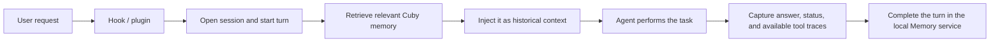

An Agent Source is Cuby's adapter for reading local history from an external Agent. Source scanning imports conversations that already exist; supported live integrations use Hooks and plugins for automatic recall and capture in new conversations.

<Callout type="warn" icon={false}>
  

    !
    History scanning and live integration are separate
  

  “Sync new” reads data the Agent has already written locally. A Hook or plugin handles automatic recall, automatic turn capture, and task resumption in new conversations. Scanning alone does not modify Agent configuration; installing a Hook, plugin, or Skill writes the files listed below.
</Callout>

## Built-in sources

| Agent | Default history source | Live integration |
| --- | --- | --- |
| Cursor | `~/Library/Application Support/Cursor/User/workspaceStorage/**/state.vscdb` and `globalStorage/state.vscdb` | Hook |
| Claude Code | `~/.claude/projects/**/*.jsonl` | Hook |
| Codex | `~/.codex/sessions/<YYYY>/<MM>/<DD>/rollout-*.jsonl` | Hook |
| OpenCode | `~/.local/share/opencode/opencode.db` | Native plugin |
| OpenClaw | Conversation and memory SQLite databases under `~/.openclaw` | Memory plugin |
| Hermes | `~/.hermes/sessions/**/*.jsonl` and `~/.hermes/state.db` | Memory Provider plugin |
| WorkBuddy | `~/.workbuddy/projects/**/*.jsonl` | Skill (on-demand memory access) |
| Pi | `~/.pi/agent/sessions/**/*.jsonl` | Skill (on-demand memory access) |
| qwenwork | `~/.qwenworkcn/projects/**/*.jsonl` | Skill (on-demand memory access) |

Cross-Agent access only shows built-in Agents whose local configuration or history source is currently detected. Undetected built-in Agents do not occupy space in the list.

## Incremental sync

- **Sync new** scans every detected source; each source can also be synced individually.
- Scans can be paused, resumed, or stopped; progress streams in real time over SSE.
- **Deep scan** uses `full` mode to backfill older history and requires a second confirmation.
- Under **Advanced actions → Add another Agent**, you can select `kimi code`, `zcode`, `minimax code`, or `coder`, or enter another Agent name.
- Adding another Agent does not require a local path. Cuby starts a discovery task that locates the history directory, identifies the message format, installs the full `cuby-memory` Skill, imports the latest 500 complete conversation turns, and saves a rule for later syncs. This flow does not install a native Hook or plugin for an unknown Agent.
- The discovery task first verifies the Agent identity against an executable, `.app`, or installed package product name. During automatic discovery, matching only ignores case, spaces, hyphens, and underscores; it does not translate, infer aliases, or match semantically. If no installed product matches, Cuby reports that the Agent was not found and stops. The user can continue by supplying absolute paths to the installation artifact, native history file or directory, and optional Skill directory so Cuby can validate only those scoped paths. Cuby does not substitute another Agent or its own history.
- During discovery and validation, a custom Agent remains an internal draft and is not shown in the Cross-Agent list. It appears only after Cuby records a verified native history path. A name reported as not found therefore does not create a visible Agent card, while the original task can still accept paths and continue onboarding.

### Why scanned-message and added-memory counts differ

The scan and “Adding” progress indicators count **messages**, while the memory pages count **memory records**. These values are not one-to-one. Cuby groups messages by source and conversation, then writes one L1 memory for each complete conversation turn:

- A user message starts a turn. Following tool, system, and Assistant messages are merged into that turn, which must start with non-empty user content and end with a non-empty Assistant message.
- One complete turn creates one L1 memory. For example, one user message, two tool messages, and one Assistant message are four processed messages but only one added memory.
- Messages reread at the watermark boundary and messages imported previously are deduplicated with conversation checkpoints, source message IDs, and stable turn IDs. A repeat sync updates or returns the same memory instead of creating a copy.
- A user-only turn, a turn without a final Assistant response, or a turn with empty boundary content is skipped until a later sync can complete it.
- An oversized turn is skipped, while a Memory service write error is counted as failed. Neither case adds a memory.

As a result, the current scan/processed-message count, the unique imported-message count, and the new-memory count can all differ. Before counting, built-in adapters also ignore non-message records, extract usable text, and redact common secrets and large Base64 payloads.

### How the date-time watermark works

Cuby maintains a separate date-time watermark for each source. This is not simply the “last scanned” time shown in the UI:

1. When the initial scan starts, Cuby stores its start time as a baseline and also records the newest message timestamp actually observed. The later of those values becomes the effective cursor for the next incremental scan.
2. On later **Sync new** runs, a built-in source selects a conversation when at least one of its messages has a timestamp **greater than or equal to** the cursor. Cuby rereads the entire selected conversation so a watermark cannot cut off the user request at the start of a turn.
3. The inclusive `>=` boundary intentionally allows the boundary message to be read again. Before import, a conversation checkpoint compares the last message timestamp, message ID, and content hash. Stable source message IDs and turn IDs then make the import itself idempotent.
4. The watermark advances to the newest observed timestamp only when scanning and import finish without errors and there are no incomplete or failed conversations. After a scan error or an unfinished turn, the watermark stays in place so the next run can retry. The displayed “last scanned” time may still change and is not the incremental cursor.

For an Agent connected through “Add another Agent” whose format Cuby discovers, the first import stores a sync boundary. Later syncs select complete turns whose starting user message is strictly later than that boundary, then use stable message and turn IDs to remove repeats.

### Images, files, and oversized turns

An image or file attachment does not cause a turn to be skipped by itself. Built-in sources extract usable text from history and replace common inline Base64 image or file payloads with a redaction marker before import.

Attachment contents, file text, tool output, or other long text may still become part of a turn. Cuby measures the UTF-8 size of the complete memory-write request (`memory.add` JSON), including the user request, tool trace, Assistant response, and request metadata. If it exceeds **2 MiB**, Cuby skips the entire turn rather than truncating it or splitting it across memories, then continues with other turns in the same sync. This is recorded as skipped rather than as a sync failure, so the sync may still complete successfully. The size limit applies to the complete turn request, not only to the user request's character count.

## Scan preferences

| Toggle | Effect |
| --- | --- |
| Auto-sync conversations | Automatically collect new conversations from connected Agents (on startup and on a schedule)—no need to click Sync new |
| Auto-connect newly found Agents | Installs the integration for a newly detected built-in Agent; the compact Skill is installed with it |

When auto-install is disabled, a detected Agent still appears in the list and you can click **Install Hook**, **Install plugin**, or **Install Skill** manually.

## Data processing and local management

- Each successfully written complete turn first becomes one raw L1 memory, then receives its summary and search index in the background.
- You can view the local data path (default `~/.cuby/memory-service`), open the directory, export `memory.sqlite`, or wipe local memory data after a second confirmation.
- Removing a Hook, plugin, or Skill does not delete imported history. Clearing local data is a separate explicit action.

## Hook and plugin integrations

Cuby connects to live Agent conversations through each host's native **Hooks** or **plugin** system. Installing an integration also installs a compact `cuby-memory` Skill for on-demand search and retrieval when the automatically injected context is not enough.

### Integration overview

| Agent | Integration | Events or interfaces used | Main effect |
| --- | --- | --- | --- |
| Cursor | Hook | `beforeSubmitPrompt`, `afterAgentResponse`, `stop` | Starts turns, records responses, captures completed turns, and supports `/cuby-resume` |
| Claude Code | Hook | `UserPromptSubmit`, `Stop` | Recalls and injects memory before a request, captures the completed turn, and supports `/cuby-resume` |
| Codex | Hook | `UserPromptSubmit`, `Stop` | Recalls and injects memory before a request, captures the completed turn, and supports `/cuby-resume` |
| OpenCode | Native plugin | Message, tool, text-completion, and session events | Recalls memory, captures responses and tool traces, and exposes native memory tools and `/cuby-resume` |
| OpenClaw | Memory plugin | `before_prompt_build`, `agent_end` | Injects memory while building the prompt, captures the completed turn, and exposes native memory tools |
| Hermes | Memory Provider plugin | Provider lifecycle methods such as `prefetch` and `sync_turn` | Recalls and captures automatically, mirrors explicit Hermes memory writes, and exposes native memory tools |
| WorkBuddy | Skill | Agent invokes `cuby-memory` | Searches, reads, and writes shared memory on demand |
| Pi | Skill | Agent invokes `cuby-memory` | Searches, reads, and writes shared memory on demand |
| qwenwork | Skill | Agent invokes `cuby-memory` | Searches, reads, and writes shared memory on demand |

### What happens during a turn

Common results after installation:

- **Automatic recall:** Claude Code, Codex, OpenCode, OpenClaw, and Hermes retrieve and inject relevant memory before normal requests run.
- **Automatic capture:** the Hook or plugin submits the user request, Agent answer, and success/failure status at the end of a turn. The Agent does not need to run `cuby-memory add` manually.
- **Task resumption:** `/cuby-resume <query>` returns up to five L1 episode candidates. Enter `1`–`5` to load the complete episode and inject continuation context. Claude Code, OpenCode, OpenClaw, and Hermes use native command entry points; Cursor, Codex, and Skill-only integrations install an explicit `cuby-resume` Skill.
- **On-demand lookup:** the bundled Skill keeps `cuby-memory search` and `cuby-memory get` for cases where automatic context is insufficient.
- **Source attribution:** captured turns carry `cursor`, `claude_code`, `codex`, `opencode`, `openclaw`, or `hermes`, so you can filter and trace their origin.

<Callout type="warn" icon={false}>
  

    !
    Cursor's current Hook focuses on automatic capture and <code>/cuby-resume</code>
  

  When a normal Cursor request needs additional memory, the bundled Skill performs an on-demand lookup. The other five integrations inject recalled context before normal requests.
</Callout>

### Cursor: three Hooks

Cuby appends its own entries to `~/.cursor/hooks.json` without replacing other Hooks.

| Hook | When it runs | What Cuby does |
| --- | --- | --- |
| `beforeSubmitPrompt` | Before the user request is submitted | Opens or reuses a Cuby session, starts a turn, stores the request, and handles `/cuby-resume` search and selection |
| `afterAgentResponse` | After the Agent produces a response | Stores the final response in the current turn state for the completion Hook |
| `stop` | When the Agent turn stops | Combines the request and response and calls turn-complete; failures are allowed through and do not block Cursor |

Written or updated by default:

- `~/.cursor/hooks.json`
- `~/.cursor/hooks/cuby-resume-hook.mjs`
- `~/.cursor/hooks/cuby-memory-config.json`
- `~/.cursor/skills/cuby-memory/SKILL.md`
- `~/.cursor/skills/cuby-resume/SKILL.md`

### Claude Code: `UserPromptSubmit` and `Stop`

| Hook | When it runs | What Cuby does |
| --- | --- | --- |
| `UserPromptSubmit` | Before the user request reaches the model | Starts a Cuby turn, puts recalled memory into `additionalContext`, and handles `/cuby-resume` |
| `Stop` | When Claude Code completes or terminates a turn | Reads the request and answer from the Hook payload or transcript, then completes the turn as `succeeded`, `failed`, or `cancelled` |

Written or updated by default:

- `~/.claude/settings.json`
- `~/.claude/hooks/cuby-resume-hook.mjs`
- `~/.claude/hooks/cuby-memory-config.json`
- `~/.claude/commands/cuby-resume.md`
- `~/.claude/CLAUDE.md`
- `~/.claude/skills/cuby-memory/SKILL.md`

### Codex: `UserPromptSubmit` and `Stop`

| Hook | When it runs | What Cuby does |
| --- | --- | --- |
| `UserPromptSubmit` | Before the user request is submitted | Starts a turn, injects recalled memory through Hook `additionalContext`, and handles `/cuby-resume` |
| `Stop` | When the Codex turn stops | Extracts the answer from the transcript or last Assistant message, completes the turn, and preserves failed or cancelled status |

Written or updated by default:

- `~/.codex/hooks.json`
- `~/.codex/hooks/cuby-resume-hook.mjs`
- `~/.codex/hooks/cuby-memory-config.json`
- `~/.codex/AGENTS.md`
- `~/.codex/skills/cuby-memory/SKILL.md`
- `~/.codex/skills/cuby-resume/SKILL.md`

### OpenCode: native plugin

| Callback | Effect |
| --- | --- |
| `chat.message` | Starts a turn, injects recalled memory automatically, and handles `/cuby-resume` |
| `tool.execute.before` / `tool.execute.after` | Captures non-Cuby tool arguments and results as part of the turn trace |
| `experimental.text.complete` / `message.part.updated` | Collects the complete Assistant text output |
| `session.error` | Marks the current turn failed and stores the error |
| `session.idle` | Completes and captures the current turn asynchronously |
| `dispose` | Flushes turns that have not yet been submitted before the plugin unloads or the process exits |

The plugin also registers the native `memmy_memory_search`, `memmy_memory_get`, and `memmy_memory_add` tools.

Written or updated under `~/.config/opencode` by default:

- `plugins/cuby-memory.js`
- `plugins/cuby-memory-config.json`
- `commands/cuby-resume.md`
- `../../../AGENTS.md`
- `skills/cuby-memory/SKILL.md`

If `OPENCODE_CONFIG_DIR` or `XDG_CONFIG_HOME` is set, Cuby writes to the corresponding configuration directory instead.

### OpenClaw: Memory plugin

| Interface | Effect |
| --- | --- |
| `registerMemoryCapability` | Tells OpenClaw that Cuby is active and that injected content is historical context |
| `before_prompt_build` | Starts a turn before prompt construction and injects recalled memory or a selected episode through `prependContext` |
| `agent_end` | Extracts the request, answer, and tool trace and completes the turn synchronously so capture is not lost on process exit |
| `registerCommand` | Registers `/cuby-resume` |
| `registerTool` | Registers `memmy_memory_search`, `memmy_memory_get`, and `memmy_memory_add` |

Installation points `plugins.slots.memory` to `cuby-memory` and enables `allowPromptInjection` and `allowConversationAccess`.

Written or updated by default:

- `~/.openclaw/extensions/cuby-memory/`
- `~/.openclaw/openclaw.json`
- `~/.openclaw/skills/cuby-memory/SKILL.md`
- `../../../AGENTS.md` in the OpenClaw workspace (default `~/.openclaw/workspace/AGENTS.md`)

OpenClaw has one memory-provider slot. If another memory plugin is already active, Cuby asks whether to replace it or keep it and install only the Skill.

### Hermes: Memory Provider plugin

| Provider interface / Hook | Effect |
| --- | --- |
| `system_prompt_block` | Declares that Cuby is active and that injected memory is historical context only |
| `prefetch` | Starts a turn before the user request and returns relevant memory context |
| `sync_turn` | Completes the turn in a background thread and captures the user request and Assistant answer |
| `on_memory_write` | Mirrors explicit memory writes from Hermes into Cuby |
| `on_session_switch` | Keeps the Cuby session aligned with the active Hermes session |
| `get_tool_schemas` / `handle_tool_call` | Exposes `memmy_memory_search`, `memmy_memory_get`, and `memmy_memory_add` |
| `pre_llm_call` / `pre_gateway_dispatch` | Recognizes a `/cuby-resume` candidate number and injects or rewrites it as full episode context |

Installation sets `memory.provider` to `cuby-memory`, enables the `memory` toolset, and enables the standalone `cuby-resume` command plugin.

Written or updated by default:

- `~/.hermes/plugins/cuby-memory/`
- `~/.hermes/plugins/cuby-resume/`
- `~/.hermes/config.yaml`
- `~/.hermes/SOUL.md`
- `~/.hermes/skills/cuby-memory/SKILL.md`

Hermes likewise allows one active Memory Provider. Cuby asks for confirmation before replacing another provider.

### Install, verify, and remove

1. Open **Memory → Cross-Agent access**.
2. For Cursor, Claude Code, and Codex, click **Install Hook**. For OpenCode, OpenClaw, and Hermes, click **Install plugin**. For WorkBuddy, Pi, and qwenwork, click **Install Skill**.
3. For another Agent, expand **Advanced actions → Add another Agent**, select a preset or enter its name, and let Cuby complete discovery and the first import.
4. If the Agent is already running, restart it or open a new session so it reloads its configuration.
5. Complete a normal turn, then confirm that the corresponding source appears in Cuby's memory or log views.
6. Enter `/cuby-resume <keywords>`, confirm that candidates appear, and select an episode with `1`–`5`.

When you click **Remove Hook**, **Remove plugin**, or **Remove Skill**, Cuby cleans up the integration content it manages. Other configuration is preserved, and memories already stored in Cuby are not deleted.

### Local access and failure behavior

- Hooks and plugins read the Memory service endpoint and token from `~/.cuby/config.yaml` and keep the runtime configuration they need in the Agent's local config directory. Do not publish these config files.
- Injected content is wrapped in `<memmy_memory_context>` as historical memory, while `<current_user_request>` identifies the authoritative current request. This reduces the risk of treating old memory as a new instruction.
- Recall and capture are **fail-open**: errors are logged and the Agent continues its current task instead of being interrupted when the Memory service is temporarily unavailable.
- Host Hook commands have a 60-second timeout; individual Memory requests have a 45-second timeout.
